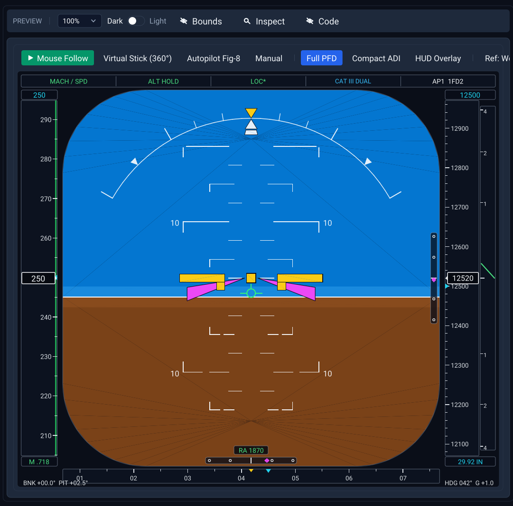
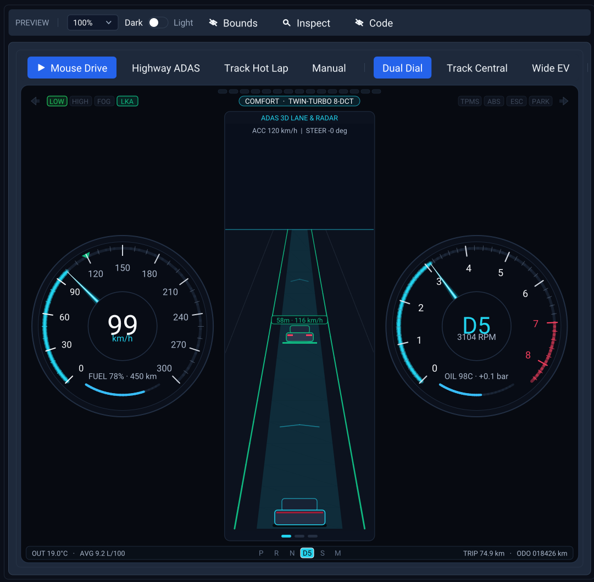

# guikit/cockpit

Avionics Primary Flight Display (`AttitudeView`) and Automotive Digital Instrument Cluster (`CarClusterView`) widgets for **[GuiKit](https://github.com/guikit/guikit)**.

| **Avionics Primary Flight Display (`AttitudeView`)** | **Automotive Cockpit & ADAS (`CarClusterView`)** |
| :---: | :---: |
|  |  |

## Widgets

- **`guikit::cockpit::AttitudeView`**: Vector Primary Flight Display (PFD) with artificial horizon, pitch ladder, bank angle arc, airspeed/altitude tapes, vertical speed indicator, slip/skid ball, and compass rose.
- **`guikit::cockpit::CarClusterView`**: Digital automotive cockpit instrument cluster with speedometer, tachometer, gear/range indicators, telltales, and ADAS lane visualization.

## Quick Usage

```cpp
#include "guikit/guikit.hpp"
#include "guikit/cockpit.hpp"

guikit::cockpit::AttitudeView(ui, flightTelemetry, {.height = guikit::SizeMode::Stretch});
guikit::cockpit::CarClusterView(ui, vehicleTelemetry, {.height = guikit::SizeMode::Stretch});
```

## CMake Integration

```cmake
add_subdirectory(guikit)
add_subdirectory(cockpit)

target_link_libraries(my_app PRIVATE guikit::guikit guikit::cockpit)
```

For the unified workspace and full interactive showcase (`guikit_demo`), see **[`guikit/bundle`](https://github.com/guikit/bundle)**.

## License

BSD Zero Clause License (`0BSD`). See [LICENSE](LICENSE) for details.
